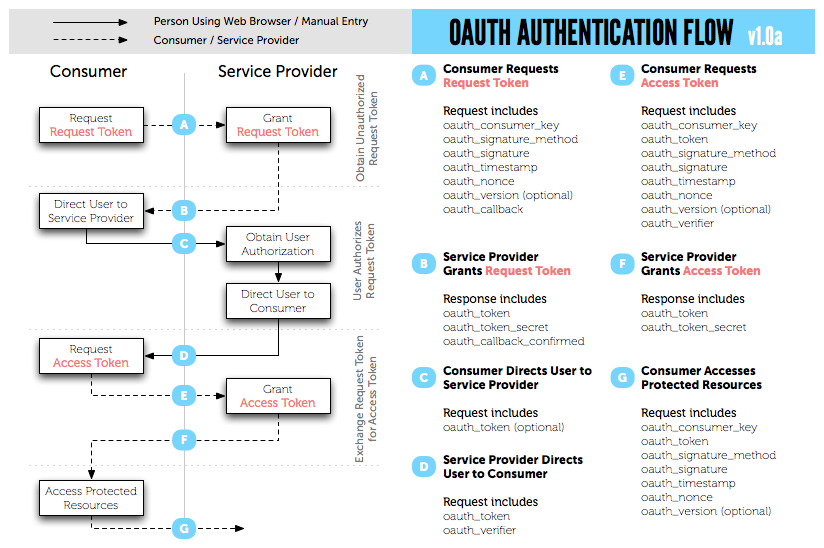

#+TITLE: OAuth 1.0 notes
#+DATE: <2012-03-15>
#+TYPE: post
#+FILETAGS: :oauth:
#+DESCRIPTION: OAuth 1.0 flow notes

* OAuth 1.0 flow
:PROPERTIES:
:CUSTOM_ID: oauth-1.0-flow
:END:
A good explanation image from [[https://oauth.net/core/1.0/][oauth.net]]:

#+caption: OAuth flow

Flow description:

- Consumer has Consumer Key and Consumer Secret (shared secret)
- A) Consumer requests Request Token
  - call =get_request_token= from Service Provider, send
    - =oauth_consumer_key=
    - =oauth_signature_method=
    - =oauth_signature=
    - ...
    - here =oauth_signature= is the signature of the request created
      using Consumer Secret, simplified example:
    - =$signature = md5($request_text . $consumer_secret)=
    - both sides (Consumer and Service Provider) know =consumer_secret=
      and are able to perform this operation, so Service Provider can
      check whether signature is valid
- B) Service provider returns Request Token
  - =oauth_token=
  - =oauth_token_secret=
- C) Consumer redirects User to Service Provider
  - =oauth_token= (request token from B)
- D) User confirms access and Service Provider redirects User to
     Consumer
  - =oauth_token= (request token from B)
  - =oauth_verifier= (request token verifier)
- E) Consumer requests Access Token
  - call =get_access_token=, send
    - =oauth_consumer_key=
    - =oauth_token= (request token from B)
    - =oauth_signature_method=
    - =oauth_signature=
    - ...
    - =oauth_verifier=
  - here =oauth_signature= is the signature of the request created using
    request token secret from B
  - note that on step A Consumer uses his Consumer Secret to sign the
    request and here he uses request token secret
- F) Service provider grants Access Token
  - =oauth_token=
  - =oauth_token_secret=
- G) Consumer Accesses Protected Resources
  - request includes
    - =oauth_consumer_key=
    - =oauth_token= (request token from F)
    - =oauth_signature_method=
    - =oauth_signature=
    - ...
    - here =oauth_signature= is created using Access Token secret

* Links
:PROPERTIES:
:CUSTOM_ID: links
:END:
[[https://en.wikipedia.org/wiki/OAuth][Wikipedia]]

[[https://oauth.net/][oauth.net]]

[[https://web.archive.org/web/20120314105758/http://hueniverse.com/oauth/][oauth guide]]

[[https://web.archive.org/web/20120309231319/http://developer.yahoo.com/oauth/guide/oauth-auth-flow.html][yahoo]]

[[https://web.archive.org/web/20120420161016/http://thinkvitamin.com/code/introduction-to-oauth/][introduction to oauth]]

[[https://habr.com/ru/articles/77648/][habrahabr, in russian]]

* Yii implementations
:PROPERTIES:
:CUSTOM_ID: yii-implementations
:END:
[[https://github.com/Nodge/yii-eauth][eauth extension]]

[[https://github.com/jorgebg/yii-eoauth][eoauth extension]]

[[https://www.yiiframework.com/extension/api-module][api module extension]]

* PHP implementations
:PROPERTIES:
:CUSTOM_ID: php-implementations
:END:
[[https://oauth.net/code/][list of libraries on oauth.net]]

[[https://web.archive.org/web/20130115222508/https://dev.twitter.com/docs/twitter-libraries#php][list of libraries on twitter.com]]

[[https://www.php.net/manual/en/book.oauth.php][php extension]]

[[https://code.google.com/archive/p/oauth-php][oauth php project]]

[[https://code.google.com/archive/p/oauth][oauth project]]

[[https://web.archive.org/web/20120906015928/http://framework.zend.com/manual/en/zend.oauth.introduction.html][zend]]
