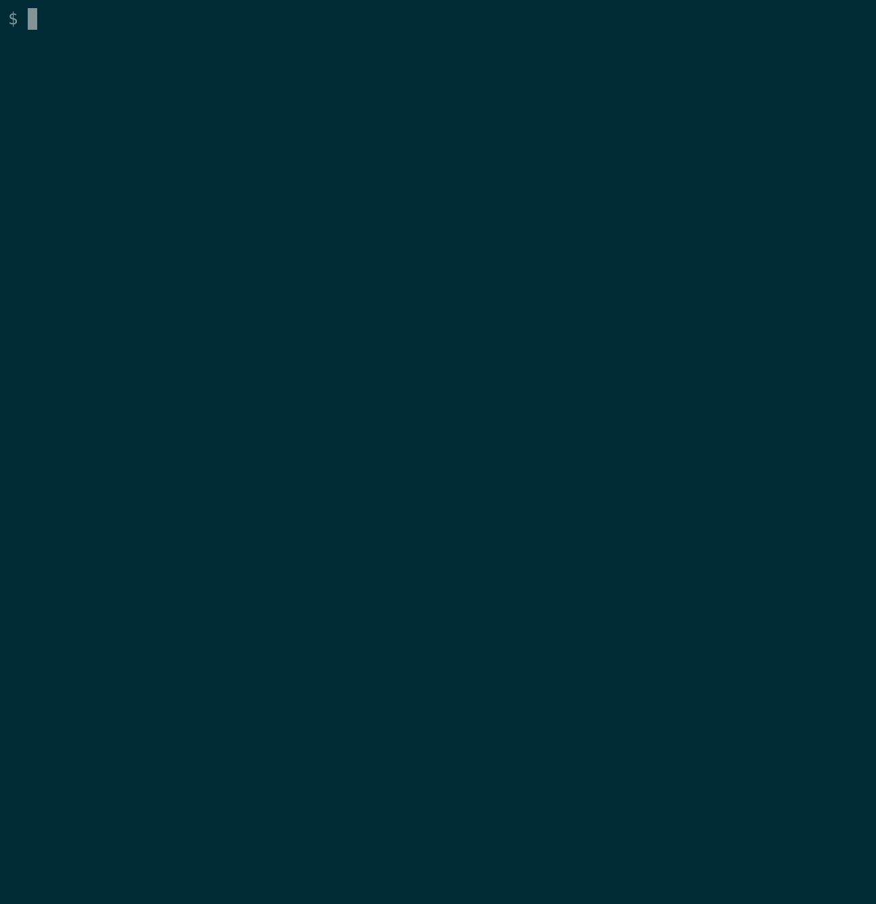

#+TITLE: Linux terminal GIF recording with asciinema
#+DATE: <2018-11-29>
#+TYPE: note
#+FILETAGS: :shell:
#+DESCRIPTION: Recording Linux Terminal Session to GIF with asciinema

The [[https://github.com/asciinema/asciinema][asciinema]] is a good and simple to use tool to record a screencast from the terminal session.

And [[https://github.com/asciinema/asciicast2gif][asciicast2gif]] allows to convert the recording to gif animation.

#+begin_example
virtualenv -p python3 venv
source venv/bin/activate

pip install asciinema
#+end_example

#+begin_example
$ asciinema
asciinema: recording asciicast to demo.cast
asciinema: press <ctrl-d> or type "exit" when you're done

...

$ <ctrl-d>
asciinema: recording finished
asciinema: asciicast saved to demo.cast
#+end_example

And convert it to gif:

#+begin_example
docker run --rm -v $PWD:/data asciinema/asciicast2gif -t solarized-dark demo.cast demo.gif
#+end_example

The result looks like this:

#+caption: asciinema demo

And the recording of the recording process :)

#+caption: asciinema self-recording

