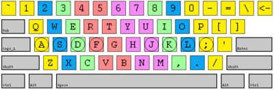

#+TITLE: Touch Typing Tutors and Games
#+DATE: <2020-01-21>
#+TYPE: note
#+FILETAGS: :kbd:
#+DESCRIPTION: A collection of links to touch typing tutors and games.

A collection of links to touch typing tutors and games.

* Online Typing Tutors
:PROPERTIES:
:CUSTOM_ID: online-typing-tutors
:END:
- [[https://keybr.com/][keybr.com]] - Typing practice, supports Qwerty, Dvorak, Colemak and Workman layouts
- [[https://typing.com/][typing.com]] - Typing practice, free
- [[https://typing.io/][typing.io]] - Typing Practice for Programmers
- [[https://monkeytype.com/][monkeytype.com]] - a minimalistic, customizable typing test, featuring many test modes,
  [[https://github.com/Miodec/monkey-type][open source]]
- [[https://entertrained.app/][entertrained.app]] - practice by typing books
- [[https://typ.ing/about][typ.ing]] - typing trainer by [[https://www.zsa.io/][zsa.io]]
- [[https://www.typinggym.com/][TypingGym]] - typing trainer with automatic level increase, article mode (long text), code mode
- [[https://climech.github.io/typing-practice/][Programmer's typing practice]] - no timers, no WPMs - just a never-ending stream of gibberish,
  [[https://github.com/climech/typing-practice][open source]]
- [[https://www.speedtyper.dev/][speedtyper.dev]] - Typing competitions for programmers, code snippets from open source projects in different languages,
  [[https://github.com/codicocodes/speedtyper.dev/tree/main][open source]]
- [[https://www.typelit.io/][typelit.io]] - practice typing by retyping entire novels
- [[https://codingspeedtest.com/][codingspeedtest.com]] - coding speed test, different languages (including [[https://codingspeedtest.com/?language=asm6502][assembly]] and [[https://codingspeedtest.com/?language=machine][machine code]])
- [[https://typingmentor.com/typing-practice/][typingmentor.com]] - typing practice, live per-word wpm measurements
- [[https://keyhero.com/][keyhero.com]] - Typing test and lessons
- [[https://www.learntyping.org/][learntyping.org]] - typing lessons with detailed explanations
- [[https://www.typingbee.com/][Typing Bee]] - typing lessons and games
- [[https://thetypingcat.com/][The Typing Cat]] - Free online keyboard typing tutor
- [[https://www.typingclub.com/][TypingClub]] - Learn Touch Typing Free
- [[https://www.ratatype.com/][Ratatype]] - Online typing tutor and typing lessons
- [[https://typingscout.com/en/][Typing Scout]] - Faster typing means more spare time :)
- [[https://10fastfingers.com/][10FastFingers.com]] - [[https://10fastfingers.com/typing-test/english][Typing Test]], Competitions, Practice & Typing Games
- [[http://typera.net/][TyperA]] - the original typing test
- [[https://www.typing.academy/][Typing Academy]] - typing test and practice
- [[https://www.typingstudy.com/][TypingStudy]] - Touch Typing Practice Online
- [[https://ranelpadon.github.io/ngram-type/][Ngram Type]] - Practice typing bigrams, trigrams, tetragrams and top words
- [[https://www.speedcoder.net/][speedcoder.net]] - Online Typing Practice for Programmers

* Other
:PROPERTIES:
:CUSTOM_ID: other
:END:
- [[https://www.shortcutfoo.com/app]] - learn shortcuts for apps (photoshop, figma, slack, etc) and editors (vim, vscode, etc)

* Online Games
:PROPERTIES:
:CUSTOM_ID: online-games
:END:
- [[https://www.nitrotype.com/][Nitro Type]] - Competitive Typing Game | Race Your Friends
- [[https://www.typinggames.zone/][typinggames.zone]] - typing games
- [[https://www.kidztype.com/browse-typing-games.html][kidztype.com]] - typing games for kids
- [[https://play.typeracer.com/][TypeRacer]] - Free typing game and competition
- [[http://klavogonki.ru/][Клавогонки]] - racing game
- [[https://zty.pe/][ZType]] - Typing Game - Type to Shoot
- [[http://hackertyper.com/][Hacker Typer]] - just start typing anything to look smart

* Desktop Games
:PROPERTIES:
:CUSTOM_ID: desktop-games
:END:
- [[http://www.epistorygame.com/][Epistory Typing chronicles]] - a beautiful atmospheric 3D action/adventure typing game
- [[https://nanotalegame.com/][Nanotale Typing Chronicles]] - one more typing adventure game - The Typing of the Dead (windows game) - [[https://en.wikipedia.org/wiki/The_Typing_of_the_Dead?oldformat=true][Wikipedia]], [[https://store.steampowered.com/app/246580/The_Typing_of_The_Dead_Overkill/][Steam]]

* Terminal and Desktop Apps
:PROPERTIES:
:CUSTOM_ID: terminal-and-desktop-apps
:END:
- [[http://www.gnu.org/software/gtypist/][GNU Typist]] (cross-platform) - typing tutor
- [[https://github.com/jankrepl/mltype][mltype]] - command-line typing practice for programmers
- [[https://github.com/unhappychoice/gittype][gittype]] - a CLI code-typing game that turns your source code into typing challenges

* Keyboard Memo
:PROPERTIES:
:CUSTOM_ID: keyboard-memo
:END:
Keyboard with finger positions:

#+caption: Keyboard Memo

Shows which key should be pressed with which finger (middle pink is for
index fingers, green for middle fingers and so on).

Grey keys: I usually use pinky here, except for the space bar).

Space bar: Press with left thumb after typing a letter with right hand
and press with the right thumb after typing a letter with left hand.
