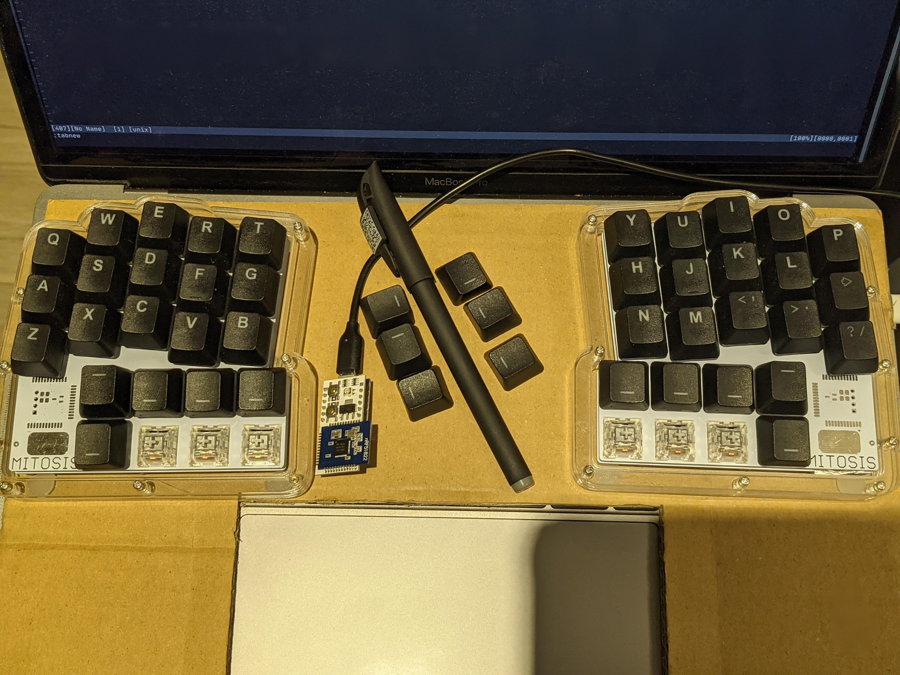
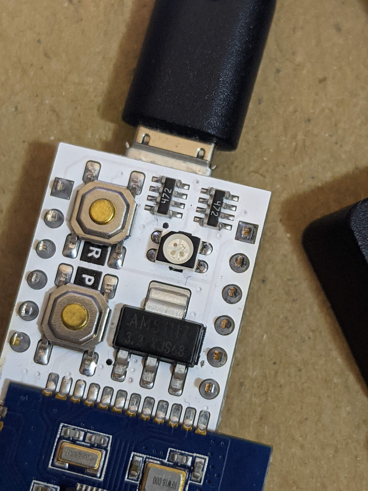
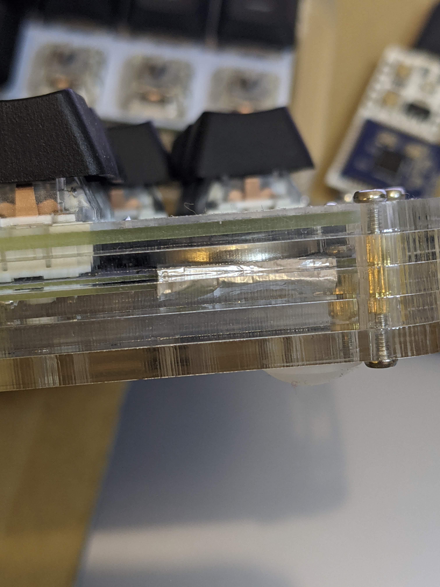

#+TITLE: Mitosis Keyboard First Impressions
#+DATE: <2020-11-22>
#+TYPE: post
#+FILETAGS: :kbd:
#+DESCRIPTION: First impressions using the Mitosis (split, custom) keyboard.

I've received my [[https://flashquark.com/product/gb-mitosis-wireless-split-ergonomic-keyboard-w-acrylic-case/][Mitosis]] a few days ago and I like it a lot so far:
- The size: perfect for the 36 keys layout I use
- The shape: very comfortable, lowered outer columns feel great for pinkies
- I wish the inner column, for the index finger would not be shifted up as it is, it causes a bit of extension to use Y and T (not a big deal though)
- I also think the bottom thumb row is too far, so I am using the top row, having the bottom one without keycaps, so it doesn't get in the way
- Wireless: probably this was one of the main reasons to get it, it is really nice to freely move both halves without having to care about wires
- An interesting decision here is to use the radio channel instead of bluetooth which gives much longer battery lifetime
- It requires a receiver to be connected to the computer, but that is not a big deal, also it is cool to realize that your keyboard (QMK) is actually running inside that small board
- Layout: not sure which layout was there initially, it was QWERTY while
  the [[https://config.qmk.fm/#/mitosis/LAYOUT][default layout in QMK configurator]] is Maltron (I think), anyway,
  I changed it to my layout, similar to [[https://configure.ergodox-ez.com/moonlander/layouts/MJvlL/latest/0][what I have on Moonlander]]
- Open source: here is the [[https://www.reddit.com/r/MechanicalKeyboards/comments/66588f/wireless_split_qmk_mitosis/][announcement post]], [[https://github.com/reversebias/mitosis-hardware][hardware]], [[https://github.com/reversebias/mitosis][receiver firmware]] and [[https://github.com/qmk/qmk_firmware/tree/master/keyboards/mitosis][keyboard firmware, QMK]]

How it :

#+caption: Mitosis.jpg

and :

#+caption: Mitosis.Receiver.jpg

Getting it to work didn't take much time, although I first had an issue
with the cable (the first one I tried didn't work, probably it was just
not a data cable) and then I had batteries upside down and one of them
didn't hold in place.

I wish there was some quick start guide, something like this:
- Unscrew PCBs from the case (inner screws)
- Put batteries into the left and right halves, they go between top and bottom plates, right bottom corner of the right half and left bottom corner of the left half
- Note that battery position is different in left and right halves
- Don't screw the PCB back yet, first make sure it works
- Find a micro-USB to USB-A/USB-C cable, it should be the data cable (so some cables may not work)
- Connect the receiver to a computer
- Try pressing keys on both halves, it should already work
- Screw the PCB back into the case
- Put on keycaps (it goes without keycaps)

If it doesn't work:
- Make sure to use a data cable for the receiver
- Make sure the batteries are inserted with the correct polarity
- There are =+= and =-= markings although I had to put my batteries upside down
  (=+= battery side facing =-= marking), not sure if markings are
  misplaced or I am interpreting them incorrectly

Flashing:
- Go to the [[https://config.qmk.fm/#/mitosis/LAYOUT][QMK configurator]], change the layout as you like
- Download json keymap (at least, for the backup, it can be loaded back later)
- Compile and download the firmware (there are buttons in the configurator) and then flash it with the [[https://github.com/qmk/qmk_toolbox/releases][QMK Toolbox]]
- Press the button with =R= near it on the receiver to reset it and go to the flashing mode

Alternatively, clone qmk and flash from the command line. Setup guide is
[[https://docs.qmk.fm/#/newbs_getting_started][here]], after everything is set up, new firmware can be compiled and flashed with
=qmk flash -kb mitosis -km mitosis_mini= (where =mitosis_mini= is the
custom keymap name, there are also several [[https://github.com/qmk/qmk_firmware/tree/master/keyboards/mitosis][alternative keymaps in the QMK source]]).

The keymap itself, can remain in =json= format, here is
[[https://github.com/serebrov/qmk_firmware/tree/custom/keyboards/mitosis/keymaps/mitosis_mini][what I have so far]]:
- config.h - defines to auto shift timeout and enables tapping force hold
- custom.c - led colors for layers (although, I have a problem with green light)
- keymap.json - the keymap made with QMK configurator
- rules.mk - enables auto shift

Compared to the [[https://configure.ergodox-ez.com/][ZSA configurator]], the QMK Configurator provides less features,
so I had to switch to the source code to enable auto shift.

I still have a few questions, maybe someone could answer these for me:

1. The battery in the right side didn't hold in the right half, I put
   aluminum foil under it to keep it in place.

Seems to work well now, but is it safe to do and to go like this in the
long term? Maybe there is a better way to fix this?

Here is how .

2. [@2] There are + / - markers on the pcb, but I had to put batteries
   upside down to make it work (so battery's plus is facing the plate
   marked with minus). Same on both sides. Am I interpreting these
   markings wrong? (it works, so not very important, I am just curious)

3. The green light doesn't seem to work in the indicator led. Is this a
   defective led or a soldering defect? How to “debug” it? The blue and
   red lights work separately and together, producing magenta, but the
   green doesn't work both on its own when combined with red or blue, it
   just stays off.

4. What do I do with several boards that I like a lot? I now have
   Ergodox EZ, Moonlander and Mitosis. Should I cycle between them daily
   or weekly?
