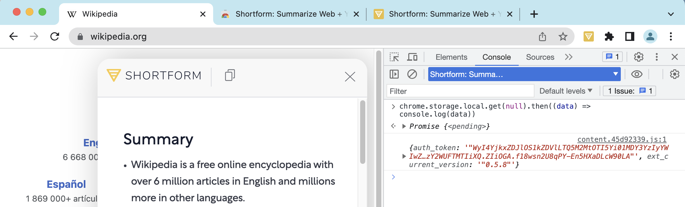

#+TITLE: How to see the Chrome Extension storage
#+DATE: <2023-06-13>
#+TYPE: note
#+FILETAGS: :web:
#+DESCRIPTION: How to inspect the chrome extension chrome.storage in DevTools

The extension storage is not displayed under the “Application” tab in
Chrome DevTools, but it is possible to access it via the javascript
console:

- Open some web page, open Chrome DevTools
- In the javascript console, select the extension context (the drop-down with “top” in it)
- Use =chrome.storage.local= to access the local storage

The =chrome.storage.local= is a [[https://developer.chrome.com/docs/extensions/reference/storage/#type-StorageArea][StorageArea]] object and it has methods to get and set values.

We can also print the entire storage by passing the =null= to the =get=
method with =chrome.storage.local.get(null).then((data) => console.log(data))=.

#+caption: extension storage access

The demo:

[[video:images/2023-06-13-chrome-extension-storage.mp4]]
