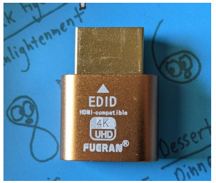

#+TITLE: MacBook: keep it on with lid closed
#+DATE: <2025-12-10>
#+TYPE: note
#+FILETAGS: :mac:
#+DESCRIPTION: How to keep MacBook on with lid closed, clamshell mode.

I am testing the [[file:2025-12-10-macbook-remote-access-from-ipad.org][remote desktop to access MacBook]] and it is inconvenient that MacBook needs to stay with the lid open.
Otherwise, if the lid is closed, the laptop goes to sleep and makes it impossible to connect to it.

The solution is to have MacBook in a [[https://www.google.com/search?q=macbook+clamshell+mode][“clamshell mode”]] which is enabled when there is an external display, mouse and keyboard connected to the laptop.

To emulate the display (which I don't have), it is possible to use the “hdmi dummy plug” or “hdmi headless adapters” like this [[https://www.amazon.com/dp/B06XSZR7CG][Fueran 4K HDR HDMI Dummy Plug]]:

#+caption: fueran hdmi dummy adapter

The Fueran HDMI adapter works for me and in my tests it is enough to have it and the external keyboard and mouse are not necessary.

Settings that may also be needed to support the clamshell mode:
+ System Settings -> Battery
+ Click Options
+ “Prevent automatic sleeping on power adapter when the display is off.” -> On

Maybe related:
+ System Settings -> Lock Screen
+ “Turn display off on power adapter when inactive” recommended to set to “Never”
+ I have it 1 hour, seems to work, so maybe this is not needed.

Resources:
+ [[https://support.apple.com/guide/mac-help/share-your-mac-resources-when-its-in-sleep-mh27905/mac][Share your Mac resources when it's in sleep]]
+ [[https://support.apple.com/guide/mac-help/set-sleep-and-wake-settings-mchle41a6ccd/mac][Set sleep and wake settings for your Mac]]
+ [[https://discussions.apple.com/thread/253886983?sortBy=rank][How to close MacBook and Use Monitor (Clamshell Mode)]]
