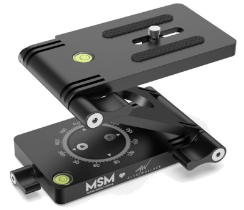
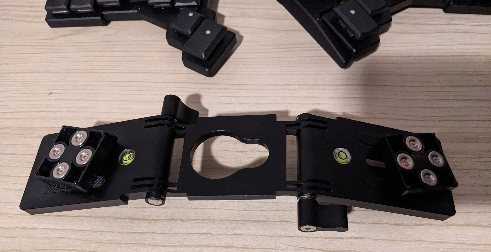
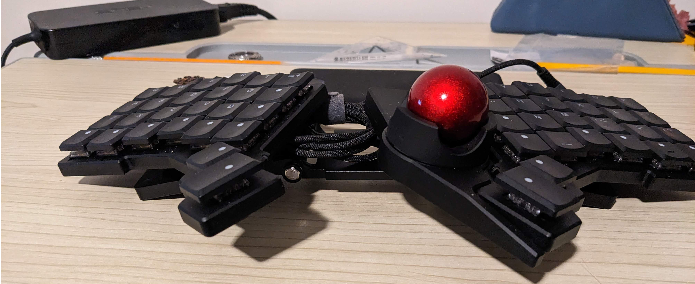
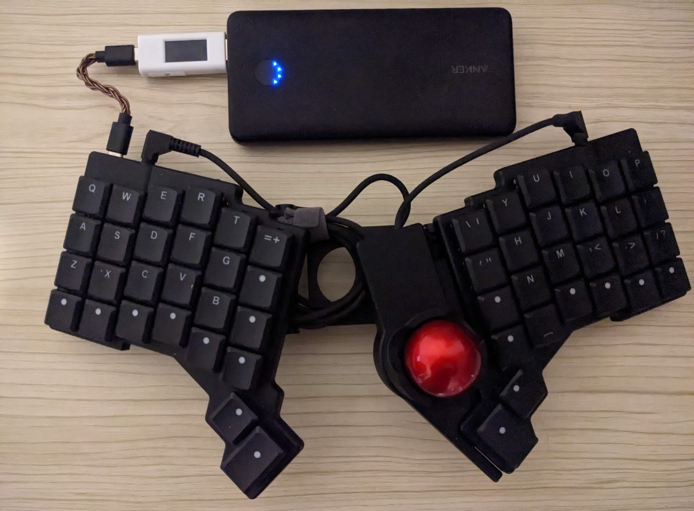
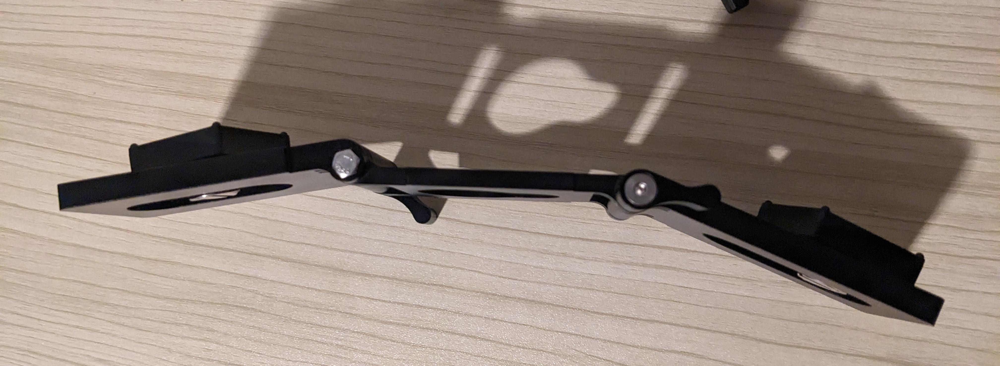
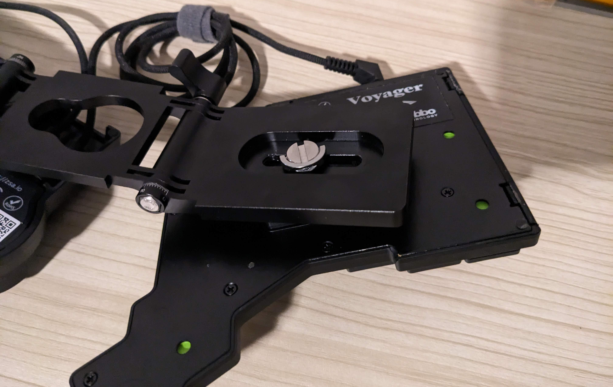
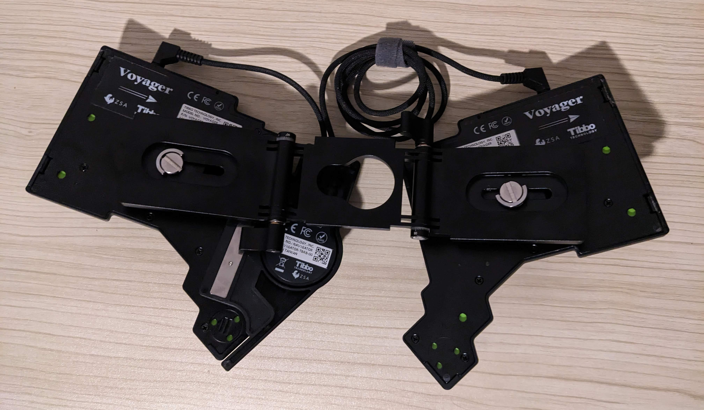

#+TITLE: Voyager keyboard: unibody mount
#+DATE: <2025-12-12>
#+TYPE: note
#+FILETAGS: :kbd:
#+DESCRIPTION: A nice unibody mount system for the Voyager keyboard.

[[https://www.zsa.io/voyager][Voyager]] is a cool compact split keyboard and it has a variety of mounting options thanks to the magnetic case and
the extra [[https://www.zsa.io/voyager/tripod-mount][magnetic mounting kit]].

I had tripod mounts for a while and I use them for tenting, although in
some situations it may be more convenient to turn the split into unibody
and thinking about my options, I found a nice solution.

The tripod mounts [[https://www.amazon.com/dp/B08Z8KX287][that I use]] look like this:

#+caption: z flex tripod head

I have two of these tripods as well as the Voyager magnetic tripod
mount. I removed the bottom part of one of the tripods (just unscrew the
locking mechanism and take the bottom arm off) and replaced it with
mountable part from the other tripod.

As a result, I can turn Voyager to unibody and also have an ability to
rotate halves both vertically and horizontally, so I can adjust the
tenting and turn halves to a convenient angle.

Here is how it looks:

There are also adjustment screws on the bottom, so halves can be moved
closer or further apart:

If you wonder about the white dongle, it is
[[http://handheldsci.com/kb][Handheld Scientific BT-600]], an adapter
that turns wired keyboard into bluetooth keyboard (besides the dongle,
you also need a powerbank to power the setup).
