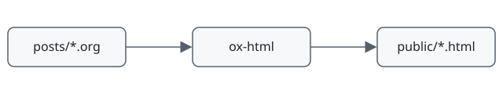

#+TITLE: Hello from org-mode
#+SUBTITLE: A sample post that shows each page feature
#+DATE: <2026-09-25 Fri>
#+FILETAGS: :org:
#+DESCRIPTION: A sample post: folding sections, code, images, video, and tables.

This post is the test page for the blog. Each section shows one feature.
Click a heading to fold or unfold its section.

* Code blocks
Emacs colors the code at build time (htmlize). Move the mouse over a block to see the copy button.

#+BEGIN_SRC python :results output :exports both
from pathlib import Path

for post in sorted(Path("posts").glob("*.org")):
    print(post.stem)
#+END_SRC

#+RESULTS:
: 2026-09-25-hello

#+BEGIN_SRC emacs-lisp
(defun blog-hello (name)
  "Return a greeting for NAME."
  (format "Hello, %s!" name))
#+END_SRC

#+BEGIN_SRC sh
make serve
#+END_SRC

Inline code also works: ~make rebuild~.

* Images
A link to a local image file becomes an image on the page.

#+CAPTION: The build pipeline.

* Video
A =video:= link becomes an HTML5 video player. The path can be a local file or a URL.

[[video:https://interactive-examples.mdn.mozilla.net/media/cc0-videos/flower.mp4]]

* A section that starts folded                                      :folded:
The =:folded:= tag on the heading closes this section when the page opens.
A link to a heading inside this section opens it: [[*Nested section][go to the nested section]].

** Nested section
Nested sections fold too.

* Tables and quotes
| Feature   | Where it is made     |
|-----------+----------------------|
| Folding   | =static/blog.js=     |
| Code      | htmlize              |
| Video     | =publish.el=         |

#+BEGIN_QUOTE
Everything is text, and that is powerful.
#+END_QUOTE
