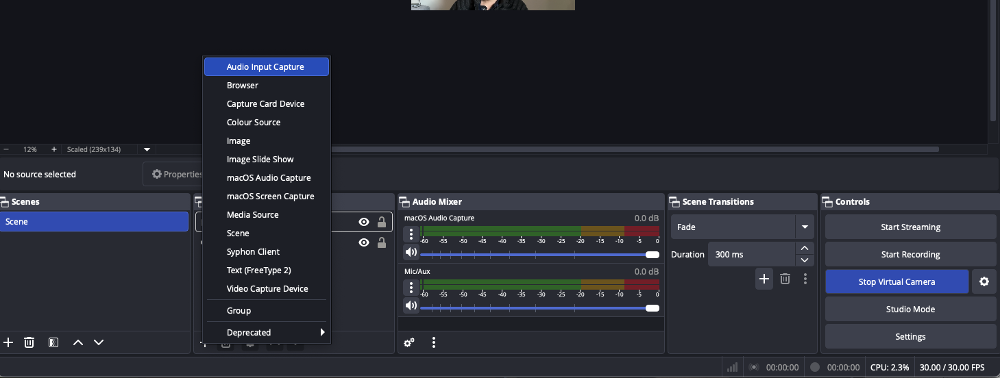
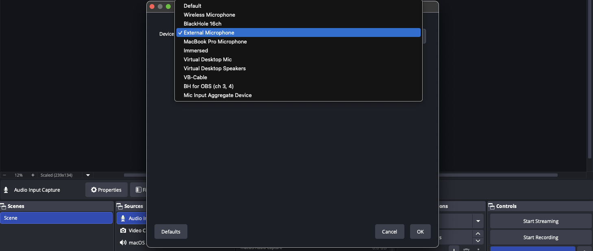
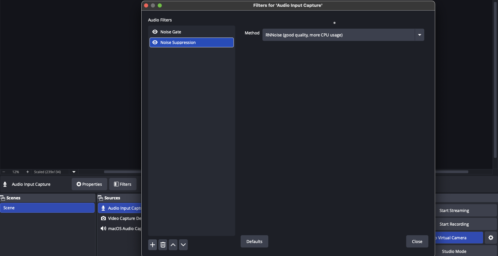
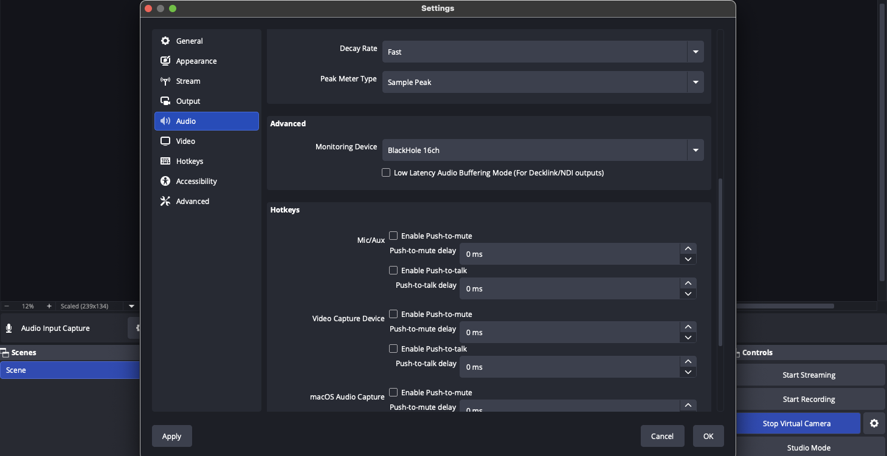
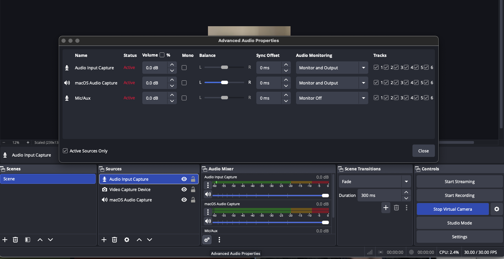
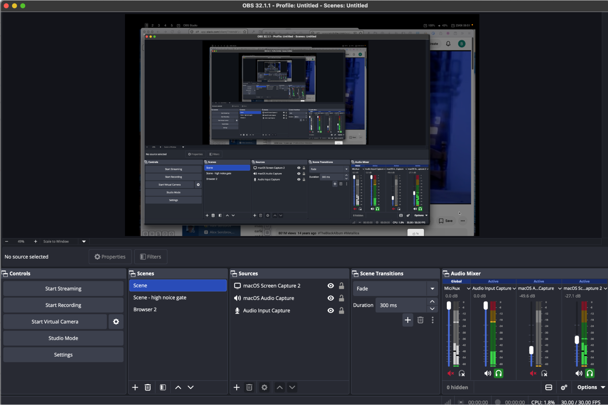
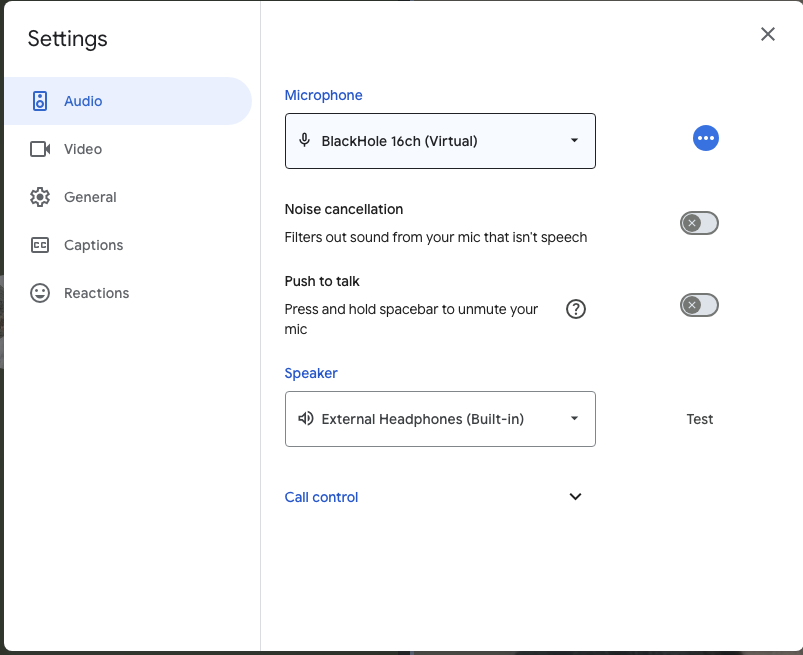
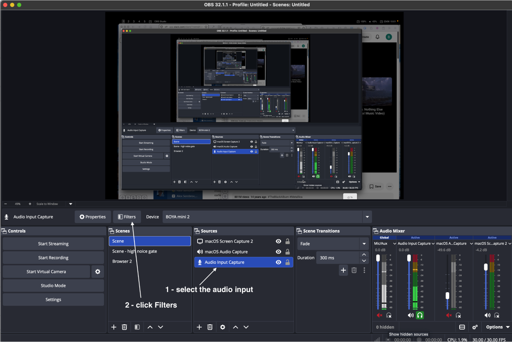
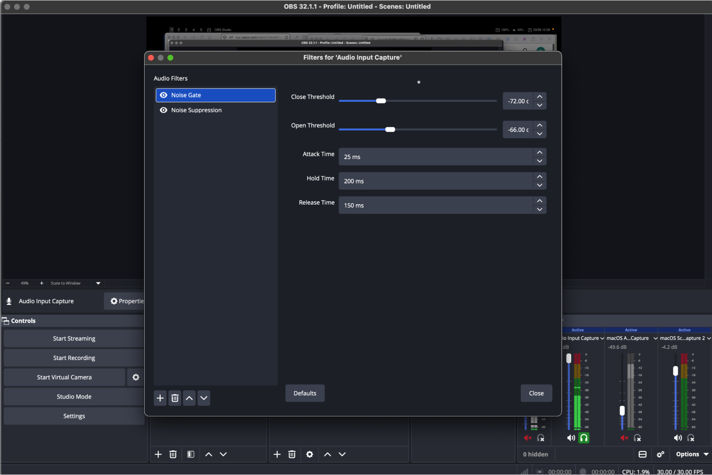

#+TITLE: OBS Setup
#+SUBTITLE: A sample post that shows each page feature
#+DATE: <2026-09-25 Fri>
#+AUTHOR: Boris Serebrov
#+DESCRIPTION: A sample post: folding sections, code, images, video, and tables.

* Purpose

Have OBS working with Google Meet, Zoom, to be able to:
+ Record the meeting
+ Share both microphone audio and desktop audio in the meeting
+ Apply OBS filters to the microphone audio to reduce noises

* Prerequisites

- Download and install OBS: [[https://obsproject.com/][https://obsproject.com/]]
- Download and install [[https://github.com/existentialaudio/blackhole][BlackHole]] or [[https://vb-audio.com/Cable/index.htm][VB-Cable]]

* Setup

How it works for audio:

#+begin_example
Input (microphone, desktop) -> OBS
-> (sends audio to) -> Blackhole (monitoring device)
-> (used as input) Google Meet, Zoom, etc
#+end_example

For video it is simpler - just "Start Virtual Camera" in OBS and use it as a video input in Google Meet.

On the OBS side:

+ Add audio source (for example external microphone

+ Add filters for audio input

Add more audio sources if needed. For example, desktop audio to be able to play music
or show apps with sound on your desktop. This can be dynamically muted/unmuted in OBS

* Install VB-Cable or Blackhole

Configure OBS to send audio to Blackhole:
+ OBS (in the system top menu) -> Preferences -> Audio -> Monitoring Device
+ We set the Monitoring device to "Blackhole" or "VB-Cable"

Change mode for audio inputs to "Monitor and Output":
+ Click the gear button at the bottom of the "Audio Mixer" block
  + or click three dots near any input in the "audio mixer" and select "Advanced Audio Properties"
+ Change "Audio Monitoring" to "Monitor and Output"

Current UI ("monitor" button is under each channel in bottom right corner, the headphones icon).
The dialog as above is also available.

Note: if you don't want to record MacOS audio (such as music playing in the background),
turn off the monitoring for the maybe "macOS audio Capture" (set to "Monitor Off"
in the dialog or click the headphone icon in the audio mixer pane to deactivate it).

In Google Meet: use "Blackhole" as audio input:

Noise cancelation settings:
+ I am using Boya mini 2 as microphone with its noise cancellation on (does not filter out everything)
+ OBS noise filter takes care of the most of the rest of the background noise
+ Google meet noise cancellation is off

OBS settings:
+ Select the "Audio Input Capture" in the "Sources" pane
+ Click "Filters" in the toolbar above
+ Add "Noise Gate"
  * Close threshold = -72 dB
  * Open threshold = -66 dB
  * Attack Time = 25 ms
  * Hold Time = 200 ms
  * Release Time = 150 ms
+ Add "Noise Suspension"
  * Method = RNNoise (good quality, more CPU usage)

How to test the setup:

+ Start google meet call on MacOS
+ Good to have some external voice input near the microphone, such as audio book playing back out loud on another device
+ Copy the link and open on yet another device
  * Use headphones here, so you can hear clearly what's going on on the other side (the one we test)
  * Phone/tablet is good here since you can walk around
+ Now the MacOS is transmitting sound and you can listen to in on another device and make sure that audio source near the microphone sounds good and no external noises are picked up
+ You (or someone else) can walk around and actually make some noises (like bang a cup on a table or a fork on a plate, etc).
+ If everything is working well, you should not hear these noises in your headphones.

* References

+ [[https://jshingler.github.io/blog/2021/01/31/obs-virtual-cables/][Obs Virtual Cables]]
+ [[https://www.youtube.com/watch?v=G5S4VNsr0Gs][Youtube:  How to Add Live Effects to Your Mic for Discord, Zoom, etc. (USING OBS)]]
  * Explains more about "how it works".
+ [[https://www.reddit.com/r/obs/comments/fvj2y4/output_obs_audio_so_that_zoom_can_use_it_as_input/][Reddit: Output OBS audio so that Zoom can use it as input]]
  * How to send OBS filtered sound to Google Meet?
  * Install VAC or VB - Audio Virtual Cable
  * In obs settings/audio set monitor to Line 1 (virtual audio cable) or VB if you're using that instead.
  * On OBS main screen where it says Audio Mixer click the gear icon and go to advanced audio properties.
  * On your mic you want to use with zoom or whatever select monitor only (mute output)
  * Now anything being sent to monitor in OBS goes through your virtual audio cable. You could also add obs virtual cam and use OBS as a webcam as well so everything you're broadcasting in OBS (video wise) is displayed as your webcam.
  * In your video chat program, whatever you decide to use.
  * Find your audio settings and make sure your Mic or Input is set to Line 1 (virtual audio cable) or VB if you're using that
  * There's a lot more you can do with OBS and chat software. Any questions just message me here. i'll try and check more often
+ [[https://www.reddit.com/r/podcasting/comments/1c93pul/good_noise_suppression_software_for_microphones/][Reddit:  Good noise suppression software for microphones]]
+ [[https://www.reddit.com/r/obs/comments/l6yt0c/best_obs_mic_settings_for_any_mic_obs_filters/][Reddit: BEST OBS Mic Settings - For ANY Mic (OBS Filters: Noise Suppression, Compressor, Noise Gate)]]
+ [[https://obsproject.com/forum/threads/mac-audio-routing-virtual-cable-ez-solution.124415/][OBS Forum: Mac Audio Routing Virtual Cable EZ solution]]
+ [[https://www.reddit.com/r/obs/comments/13nqyov/noise_suppression_mic_filter_is_a_lifesaver_how/][Reddit:  Noise Suppression mic filter is a lifesaver, how can I constantly have this on my PC?]]

Note on aggregate devices: some guides use aggregate devices, but that is not necessary.
It is possible to create an aggregate device (ie blackhole + headphones)  and then use it as Monitor in OBS, but I haven't notice any difference.

Q: how exactly aggregate devices work?
+ What happens when I use blackhole aggregate device to record Google Meet?
+ Related: [[https://www.youtube.com/watch?v=vpegwQvQJMc][Youtube: Record Your Mac's Audio for Free (QuickTime Hack)]]

Q: OBS studio has the "mix/aux" channel by default, it it necessary to add an audio source explicitly?
+ I was not able to actually get anything from mic/aux and also I can't add filters for it, so maybe this is something separate.

Related: [[https://www.reddit.com/r/Twitch/comments/14lx1ea/comment/jpyr6re/][Reddit comment]]
+ This is a really tough situation and one I share with my wife, who is sitting four-ish feet away from me.
+ Here are the things I did to reduce my voice on her end:
  + 1. Get a [[https://www.reddit.com/search/?q=Dynamic+Microphone+Twitch+streaming&cId=6a950a59-7215-45b4-b00b-dc2faf27d459&iId=6f99a407-de88-4329-b410-047887371872][Dynamic Microphone]] and mount it to your desk using a boom arm so that the speaking side (usually the top) is pointing to you and away from your BF. I bought her the[ Tonor TD510 USB/XLR Mic](https://www.tonormic.com/products/td510-usb-xlr-dynamic-microphone) and it is SURPRISINGLY good for the $60 price point.
    + 1b) Make sure the microphone is close to you, and with close I mean for a Dynamic Microphone you should be able to practically kiss it (4-6 inches) and for a condenser mic (which you have now) you should have it about 8-10 inches away at the most. Closer *is* better.
    + 1c) With your microphone so close you are probably a LOT louder, So turn your Gain (the knob on the Wave or the buttons on the Tonor) right down until your normal streaming voice hits the top of the green or right in the yellow. (-15 to 10dB)
  + 2) In OBS it is time to set up some filters, starting with [[https://www.reddit.com/search/?q=Noise+Suppression+OBS+Twitch&cId=8b43aecd-7135-4090-b437-2c90d37a2b99&iId=3631a29b-afa9-4385-9794-bf6592368272][Noise Suppression]]. Pick the filter you think works best - I prefer RNN Noise over RTX for example - such that your voice stays clear and unmuddied while removing as much noise from your BF as possible.
  + 3) After noise suppression, get your BF to play a game and be loud about it. Look at what levels on your microphone he hits. If this is -45dB or lower this is great, because that means that you -should- be able to top that with your own voice.
    + 3b) Speak as loud as you normally do into your mic, then pretend you have a little intimate moment with your viewers and give them a whisper. Check what the lowest is you get while you whisper. If that is under -20dB you may want to add a little Gain filter and just up it 3-5dB, but make sure it is **below** your Noise Suppression. Suppress first, then add gain.
    + 3c) If that is well clear of your BF then you -could- add a Noise Gate on top of the noise suppression to just remove your BF entirely -unless- you are speaking too.
  + 4) Now it is time to test your highs: Talk as if you are normally streaming - and really check the dB on this one - , then get excited, get scared, scream for a bit. It will probably be WAY too loud (peaking or high reds). Now we are going to add a compression filter. Set the ratio to 4:1 and set the attentuation to 3-5dB **under** your normal speaking voice dB.
    + 4b) Now speak again at your normal volume and use the make-up gain slider to -just- hit the yellow if you need to. Just make sure not to push it too far (don't add anything more than 6dB).
  + 5) Add one last filter: A Limiter. Set it to -3dB. This will cut you off completely if you are about to peak. It is a really good idea to have because it is great for your viewers if you don't make their ears bleed.
+ And that's it. Give it another test: Whisper, Talk, Scream. You should never hit below -20dB while whispering and never clip (fill the whole dB bar) when screaming. If you have any questions, feel free to drop them below.
